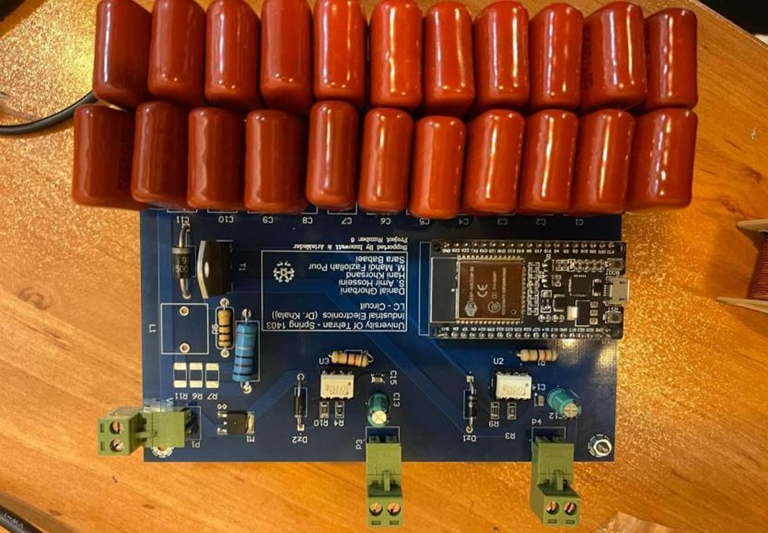
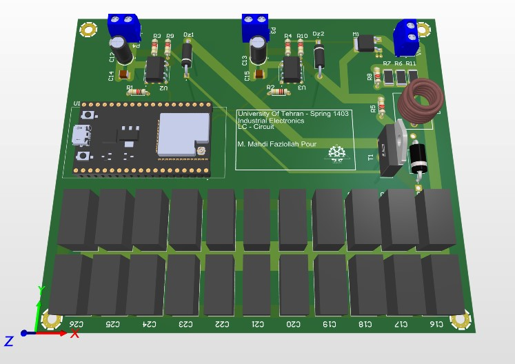

# Project Images

This directory contains images documenting the design and experimental implementation of the LC resonant pulse generator.

The images include:

- PCB layout and 3D visualization
- Assembled hardware prototype
- Laboratory measurement setup

## Image Gallery

### Assembled PCB

### PCB 3D View

### Laboratory Testing

