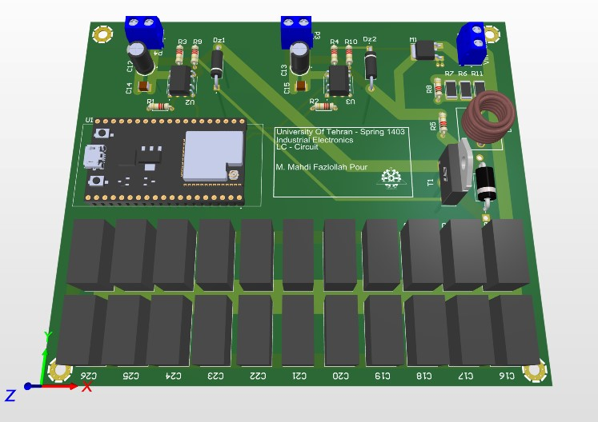
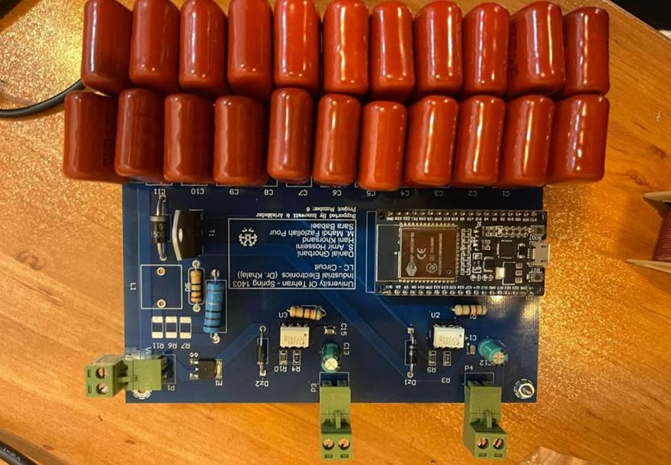

## PCB Design and Hardware Prototype

  

  <strong>Figure 1. PCB 3D View</strong>

  Three-dimensional visualization of the PCB layout,
  showing component placement and the integration
  of power and control circuitry.

  

  <strong>Figure 2. Assembled PCB</strong>

  Fabricated and assembled hardware prototype
  used for laboratory implementation and testing.

The circuit schematic and PCB layout were developed using
Altium Designer. The assembled board integrates the
LC resonant power stage, switching devices, isolated
gate-driving circuits, and controller connections.

[**View Hardware Design Files**](Hardware/)
